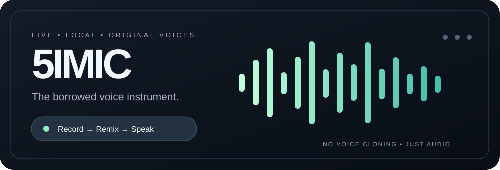
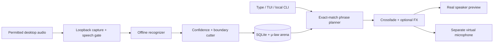

<div align="center">




# 5imic · Borrowed Voice Studio

**Catch a phrase. Collect its texture. Give it a completely new sentence.**

A local-first, cross-platform voice instrument that listens to permitted live speech, extracts reusable word and phrase recordings, and stitches them into new lines without generating a cloned voice.

[](https://github.com/5ivesaw/5imic/actions/workflows/release.yml)
[](LICENSE)
[](#get-started)

[**Download builds**](https://github.com/5ivesaw/5imic/releases) · [**Quick start**](#get-started) · [**How it works**](#under-the-hood) · [**Known limits**](#what-it-does-not-promise)

</div>

---

## More instrument than AI voice changer

5imic is **live concatenative speech synthesis**. It takes actual audio snippets from a session, keeping their mic character, intonation, and weirdly human rough edges. Each word you type is matched against real indexed recordings. If the words aren't there, **5imic tells you** instead of making up an unrelated sentence.

| Capability | What you get |
|:---|:---|
| **One-command studio** | Desktop control panel, one-line pinned quick-type pill, or interactive terminal session |
| **Universal audio approach** | Desktop output loopback capture; virtual microphone output for compatible voice apps |
| **Two recognition families** | Faster Whisper tiny/base/small (CPU INT8) or lightweight Vosk small |
| **Confidence-aware clips** | Reject low-confidence words instead of storing every uncertain transcript |
| **Boundary-aware cuts** | Preserve connected phrases when a seam isn't clean; save shorter units where possible |
| **Exact phrase planner** | Dynamic programming picks a non-overlapping sequence, reports missing words and coverage |
| **Voice modes** | Natural, low, high and chaos variation from recorded clips |
| **Small private library** | 12 kHz, 8-bit μ-law arena; SQLite WAL index; 200 MB default cap, clip browser and pins |
| **Preview and send** | Hear a direct local preview while sending the same clips to a separate virtual mic |
| **Voice puppet mode** | Hold the GUI talk button, or use `:talk 3` in the TUI, to recognize your real mic and speak using collected clips |
| **Optional texture** | Clean, light crush, or deliberately glitched repeats |

### Why the audio can't spiral into screaming feedback

The application **does not** connect desktop audio into its virtual mic. Capture reads your chosen playback device's *monitor* using the OS audio API. Synthesized audio goes to a *separate* output and optionally your real speakers. Capture pauses while 5imic plays, with a cooldown to discard the delayed monitor tail. The Linux setup creates a null sink and remapped microphone source only; no capture-to-output loopback modules are created.

This prevents the specific routing loop that caused runaway playback in earlier experiments. External audio apps can still be misrouted, so avoid monitoring the virtual mic back into the same capture path through another program.

## Get started

### Windows 10/11

1. Open [**Releases**](https://github.com/5ivesaw/5imic/releases) and extract **5imic-Windows-x64.zip**.
2. Double-click **5imic.exe** inside the extracted folder.
3. Click **Start recording** after choosing a permitted source and letting the first-use model download finish.
4. To send the audio as a microphone, install a virtual audio cable (for example, [VB-CABLE from VB-Audio](https://vb-audio.com/Cable/)) and select **CABLE Output** as your microphone in the target app. 5imic plays into **CABLE Input** automatically when available. Driver installation requires Windows permission/restart in some setups.

The app can **preview through speakers even without a virtual cable**. Windows doesn't allow an ordinary app to manufacture a new system microphone without a virtual audio device/driver. No unsafe automatic admin-level driver installation is performed.

### Linux · PipeWire / PulseAudio

1. Download and extract **5imic-Linux-x64.tar.gz** from [Releases](https://github.com/5ivesaw/5imic/releases).
2. Run:

   ```bash
   ./5imic/5imic
   ```
3. The app creates a virtual output and **5imic Virtual Microphone** input using `pactl` (provided by most PipeWire/PulseAudio desktop installations).
4. Select **5imic Virtual Microphone** as the microphone in your game/call app. Use the GUI's pinned quick-type bar or the terminal to talk.

Linux GUI builds require a running graphical session and a PulseAudio-compatible audio service; some distributions need `pulseaudio-utils` for `pactl`. If a virtual mic cannot be created, direct preview still works. Restart the target app after adding a virtual input if it doesn't notice new devices.

### Source install · both platforms

Requires Python 3.10+ and system audio libraries. The first recognition model is downloaded on demand.

```bash
python -m pip install "git+https://github.com/5ivesaw/5imic.git"
5imic
```

On Linux, `python3-tk` and PulseAudio compatibility libraries may be required by your distribution; on Windows, the Python installer normally includes Tk. For isolated installs, replace pip with `pipx install`.

If you downloaded the complete **source ZIP**, extract it and use `bash launch.sh`
on Linux or double-click `launch.cmd` on Windows. These create a private Python
environment, install dependencies once, and launch the same app. They require
Python to be installed; the GitHub Release archives are intended to remove
that requirement after CI produces them.

## One terminal does everything

```console
$ 5imic tui
▥ 5IMIC / LIVE VOICE CONSOLE
Type a sentence to play it. Recording is paused until F2 or :record.

5imic › :record
Recording: True
5imic › :stats
Clips            184
Phrases          66
5imic › hello there
Spoken           hello there
Coverage         1.0
```

The terminal's live bottom bar tracks recording, indexed clips, storage, mode, and effects. **F2** toggles capture without another terminal. Typing a sentence plays it. Commands include `:talk 3` (mic puppet for three seconds), `:clips`, `:mode high`, `:fx glitch`, `:model vosk-small-en`, `:pin 123`, and `:partial words I have`. `:quit` cleans up audio modules created by the app.

From another shell, while the app is running:

```bash
5imic say "hello there"
5imic stats
5imic clips
5imic pin 123
5imic record
5imic mode chaos
5imic effect crush
5imic devices
5imic doctor
5imic models list
5imic models install vosk-small-en
5imic models set whisper-base.en
5imic ingest speech-test.wav
```

The CLI talks to your running app over an authenticated `127.0.0.1` connection. It doesn't spin up a second recorder or require three independent daemon windows.

## Under the hood



- Desktop loopback capture is handled through SoundCard (Windows WASAPI, Linux PulseAudio/PipeWire compatibility).
- The recognition worker is separate from capture and display. It ingests short utterances, not endless chunks of silence. Speech detection uses a cheap energy gate for now.
- Word timings produce conservative clean/uncertain seams. Isolated words and connected phrases are indexed, but **acoustic separation is heuristic** and should be improved through real recorded samples.
- A phrase planning pass only covers input tokens that match a recording exactly, maximizing coverage without replaying overlapping subphrases. The default will refuse playback below **80% coverage**; `--partial` is an explicit override.
- Every indexed clip is stored once in a compact 8-bit μ-law arena, with pitch/brightness/loudness metadata. The store retains at most five versions of each phrase; unpinned clips are pruned when space is tight.
- Linux audio modules are cleaned up on exit if 5imic created them. A process crash may leave a virtual device, but not a capture-to-output feedback route.

## Choosing recognition for your machine

| Backend | Intended use | Tradeoff |
|:---|:---|:---|
| `whisper-tiny.en` (default) | CPU-friendly accuracy baseline | More memory/compute than Vosk; first model download |
| `whisper-base.en` | Better recognition where the CPU can handle it | Higher latency |
| `whisper-small.en` | Higher-quality indexing on fast hardware | Heaviest option; not recommended while gaming on old laptops |
| `vosk-small-en` | Lowest-cost streaming-class engine | Lower accuracy in noisy, accented, overlapping speech |

All models run on the device, and English is the current target language. A model can be selected in the GUI or using `5imic models set NAME`. Whisper backends download through their upstream model cache; Vosk downloads the official small English model.

Confidence is configurable via `settings.json` (default **0.65**). It is not a probability of correctness across all models, so tune it with samples from your actual audio. A high score cannot guarantee accurate words.

## What it does **not** promise

- **Not real-time voice cloning:** It can only say what the recorded word/phrase inventory can cover. An empty lobby has no magical starter voice.
- **Not universal “zero setup” microphone creation:** Windows still needs a virtual audio driver for app transmission; microphone input must be selected in your voice-chat app.
- **Not 20 ms speech recognition:** End-to-end time includes actual speaking, pause detection, model inference, buffering, and output duration. It depends heavily on your machine and audio.
- **Not perfect transcription:** Overlap, music, noise, accents, and compressed voice chat can still cause mistakes. The confidence gate is a safeguard, not a guarantee.
- **Not global key capture on every Wayland/game environment:** The pill is a normal topmost window, not an injected fullscreen overlay or keylogger. Use window shortcuts or the TUI.
- **Not a consent bypass:** Only record people who know and agree to have their voice sampled. Respect platform rules, local law, and privacy. Recordings stay on your machine and can be cleared.

## Troubleshooting

| Symptom | What to check |
|:---|:---|
| No clips arrive | Start recording; run `5imic doctor`; verify the correct speaker/loopback. Some apps use a different audio output than the desktop default. |
| Wrong words | Try `whisper-base.en`, lower background audio, use a dedicated voice-only playback device, or raise confidence. |
| “No matching recorded words” | Let the session develop or type only known words. No substitute words are invented. |
| You hear a preview but nobody else does | Select the virtual input in your voice app; Windows requires an installed cable driver; unmute input. |
| No preview | Verify system speaker output and 5imic's monitor setting. |
| Too much CPU | Switch to Vosk; reduce other audio loads; avoid Whisper small on older CPUs. |
| No Linux virtual mic | Ensure `pactl` is installed and PipeWire-Pulse/PulseAudio is running. |
| Distortion or feedback | Disable external “listen to this device”/mic monitoring routes into the captured output; use `5imic doctor`. 5imic itself never links capture into output. |

Settings and recordings live in `%LOCALAPPDATA%\5imic` (Windows) or `~/.local/share/5imic` (Linux, respecting `XDG_DATA_HOME`). Set `FIVEIMIC_HOME` to relocate them. `clips.db` and `audio.ulaw` are private local assets; they are never pushed to the repo.

## Development

```bash
python -m pip install -e ".[dev]"
python -m pytest -q
python -m fiveimic tui
```

The GitHub workflow tests on both OSes, builds onedir portable distributions, uploads CI artifacts, and publishes release archives when all jobs pass. Model weights are downloaded on first use rather than making every release download enormous.

**Next milestones:** separate per-app voice capture, smarter VAD, robust speaker segmentation, on-device timestamp alignment audits, editable clip browser, and more faithful seam-quality evaluation on human-annotated samples. Contributions and reproducible audio bug reports are especially welcome.

---

<div align="center">

**5imic** — *the voice is the sample.*

Built for people who love sound enough to pull it apart and play with it.

</div>
